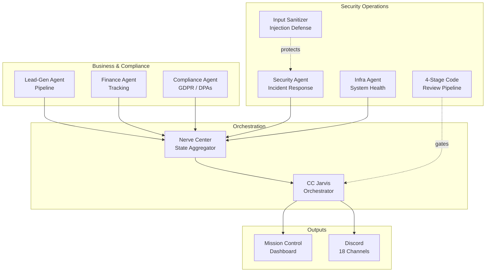

# CyberPort
knowing-eysh: Cybersecurity Portfolio
I love books 📖, nature 🌅, and tech 👩‍💻

**[→ View my live resume at eyshtech.vip](https://eyshtech.vip)**

# Hi, I'm Eysha 👋

## Professional Statement
I am a proactive systems and security technologist dedicated to maintaining mission assurance through resilient defensive engineering and workflow automation. Combining practical enterprise administration with advancing skills in Python scripting and network protocol security, I focus on identifying anomalies early and reducing attack surfaces across interconnected environments. Long-term, I'm working toward ethical hacking and offensive security — and wherever that leads in applied AI — with Identity & Access Management (IAM) as a particular area of focus. I am driven to help organizations maintain high-availability standards while safeguarding sensitive data against evolving threats.

---

### 🛡️ Core Competencies & Skills
* **Administration & Platforms:** Google Workspace Enterprise, Gemini Apps, Linux/macOS Administration, Identity & Access Management (IAM)
* **Active Technical Focus:** Python Automation, Network Protocol Analysis, Defense-in-Depth, Vulnerability Mitigation
* **Career Direction:** Ethical Hacking / Offensive Security, AI Security, Identity & Access Management (IAM)
* **Languages & Stack:** Python, TypeScript, HTML/CSS/JS, REST APIs, SQL (PostgreSQL via Supabase)
* **Target Certifications:** CompTIA Network+, CompTIA Security+

---

### 🎓 Education
**B.S., Cybersecurity & Information Assurance** — *In Progress*
Degree program includes a built-in pathway to 14 industry certifications (in progress, details to follow as completed).

---

### 🔭 Current Projects & Focus
* Developing Python automation playbooks for telemetry collection and log parsing.
* Hardening local and cloud endpoint architectures using Least Privilege principles.

---

### 🚀 Featured Projects

**[eyshtech-vip](https://github.com/cosmicgrimoire26-dotcom/eyshtech-vip)** — Google Workspace Security & AI Consulting
*Tech: `HTML` · `CSS` · `JavaScript`*
* Built automated domain security auditing tooling covering SPF/DKIM/DMARC configuration and SSL validity checks.
* Developed a Google Workspace security audit tool used in client engagements to assess admin/IAM configuration.

**jarvis-brain** *(private repository)* — Multi-Agent Security & Business Operations Platform
*Tech: `Python` · `HTML/CSS/JS` · `REST APIs` · `cron` / `launchd` · `Discord API` · `Google Workspace APIs`*

Architected and operated a 15-agent autonomous automation platform — Python backend, cron/launchd-scheduled, with a centralized "Nerve Center" state aggregator unifying all agent output into one source of truth. Agents span four domains:

* **Security Operations** — automated incident report generation, breach monitoring (HIBP), weekly audits scanning every installed extension for prompt-extraction/credential-access/unsafe-dynamic-execution patterns, and automatic firewall-level IP blocking on detected probes.
* **Infrastructure & System Health** — uptime/health monitoring, automated threat investigation, self-healing recovery checks, and a dashboard auditor that cross-references live state against source files to catch drift.
* **Defense-in-Depth Controls** — a prompt-injection input sanitizer (blocks dangerous URL schemes, flags instruction-override/obfuscation attempts), path-based credential isolation (blocks agent access to secrets/keys/env files), command allowlisting with enforced policy gates, and a 4-stage security review pipeline (static malicious-pattern scanning, Snyk dependency scanning, threat-intel lookups, binary/VirusTotal-style scanning) gating any third-party code before it executes.
* **Business & Compliance Operations** — financial tracking, regulatory/compliance monitoring (GDPR, vendor Data Processing Agreements), lead-generation with domain validation and confidence scoring, and job-search/freelance pipeline automation.

Also built the operations dashboard itself: a self-contained HTML/CSS/JS "Mission Control" UI with a REST API backend for live remote control, plus Discord REST API integration routing notifications across 18 channels.

**grimoire** *(private repository)* — Full-Stack SaaS Application
*Tech: `TypeScript` · `Next.js` · `Supabase (PostgreSQL)` · `Stripe`*
* Implemented Row-Level Security across all database tables and audited/hardened every API route for authentication and rate limiting.
* Led data-protection compliance: GDPR-aligned privacy policy, COPPA-compliant age-gating, and vendor Data Processing Agreement management.

**grimoire-shop** *(private repository)* — E-Commerce Platform
*Tech: `TypeScript` · `Next.js` · `Supabase (PostgreSQL)` · `Stripe`*
* Implemented verified Stripe webhook signature validation and Row-Level Security on all customer/order data.
* Audited the checkout and fulfillment pipeline for data exposure and injection risk.

**Google Workspace Security Audit** *(past offering)* — Independent Consulting Service
* Admin console configuration review, org-unit/group structure analysis, user access analysis, 2FA enforcement verification, sharing-settings audit, and data-loss-prevention policy review.
* Delivered as a structured client-facing engagement, not a lab exercise.

*Private repositories are available on request for recruiters/employers — happy to walk through the code directly.*

---

### 💼 Client Work

**[20 West Insurance](https://www.20westinsurance.com)** — Full Business Website
*Tech: `Wix`*
Designed and built the complete website end-to-end for a multi-line insurance agency (health, life, Medicare, auto, home, commercial).

**[All South Senior Insurance](https://www.assistseniorinsurance.com)** — Website + Automated Intake Funnel
*Tech: `Wix` · `n8n`*
Built the client website end-to-end and designed an automated lead-intake funnel using n8n workflow automation for a Medicare enrollment support service.

---

### 🏅 Notable Achievement

**State Insurance Licensing — Georgia & South Carolina**
Self-directed licensing path pursued since 2024, alongside a full-time sales career. Passed in-person, proctored state licensing exams in both states — on the first attempt — plus a Medicare Certification (2026). That licensing and domain credibility directly led to being brought on to build the two client sites above. Didn't continue pursuing insurance as a career, but the discipline of learning and passing regulated, exam-based material under pressure carries directly into certification work now (CompTIA Security+/Network+).
